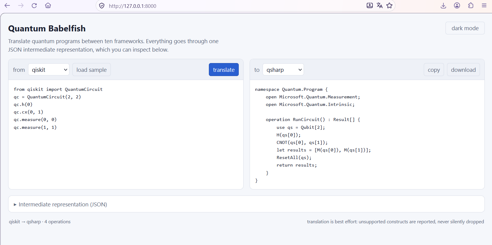

# Quantum Babelfish 🐟⚛️

A universal translator for 10 quantum code languages.
It reads source code of one quantum framework,
lifts it into a language-neutral JSON intermediate representation (IR), 
and emits the equivalent program into another framework.

```
qiskit    ─┐                      ┌─> qiskit
cirq      ─┤                      ├─> cirq
pennylane ─┤                      ├─> pennylane
qsharp    ─┤                      ├─> qsharp
cudaq     ─┤                      ├─> cudaq
braket    ─┤    ──> JSON IR ──    ├─> braket
pytket    ─┤                      ├─> pytket
openqasm  ─┤                      ├─> openqasm
pyquil    ─┤                      ├─> pyquil
qulacs    ─┘                      └─> qulacs
```

qbabel is a commandline **source-to-source translator**, not a compiler or simulator.
Everything is plain text in, plain text out, with a JSON IR in the middle that you can read, validate and archive.
You can start as a webservice http://127.0.0.1:8000 and interactively code and convert.



## Supported languages

All ten are available as both input and output:

| language | vendor | input | output |
| --- | --- | :---: | :---: |
| Qiskit | IBM | ✅ | ✅ |
| Cirq | Google | ✅ | ✅ |
| PennyLane | Xanadu | ✅ | ✅ |
| Q# (`qsharp`) | Microsoft | ✅ | ✅ |
| CUDA-Q (`cudaq`) | NVIDIA | ✅ | ✅ |
| Amazon Braket (`braket`) | AWS | ✅ | ✅ |
| pytket | Quantinuum | ✅ | ✅ |
| OpenQASM 2/3 (`openqasm`) | open standard | ✅ | ✅ |
| PyQuil (`pyquil`) | Rigetti | ✅ | ✅ |
| Qulacs | QunaSys | ✅ | ✅ |

Not every pair round-trips perfectly — see [Limitations](#limitations).

## Layout

```
qbabel_core.py       translator core: parsers, IR, emitters (standard library only)
qbabel               command line tool
quantum_schema.json  JSON Schema for the intermediate representation
web/                 FastAPI backend + browser playground
  app.py
  static/            index.html, style.css, app.js
  run.sh             sets up a venv with uv and starts the server
tests/               5 worked examples, plus run_tests.sh
screenshot.png       Webinterface
```

The core (`qbabel_core.py`) has **no third-party dependencies**. The web server
needs FastAPI and uvicorn; the verification tool needs httpx.

## Requirements

- Python 3.9 or newer for the core and the CLI.
- [`uv`](https://docs.astral.sh/uv/) only if you want the web playground or the
  verification tool (their `run.sh`/scripts create a `.venv` for you).

## Command line

```bash
./qbabel --from qiskit --fromfile bell.py --to qsharp --tofile bell.qs
```

Output on a successful run:

```
translated qiskit -> qsharp (3 operations)
intermediate IR: bell_ir.json
```

Options:

| flag | required | meaning |
| --- | :---: | --- |
| `--from` | yes | source language |
| `--fromfile` | yes | file containing the source program |
| `--to` | yes | target language |
| `--tofile` | yes | where to write the translated program |
| `--irfile` | no | where to write the intermediate JSON |
| `--quiet` | no | suppress warnings on stderr |

`--from` and `--to` are validated against the supported set, so a typo fails
fast. The IR path defaults to the `--tofile` path with its extension replaced by
`_ir.json` (`bell.qs` → `bell_ir.json`). Missing directories are created
automatically. Warnings (gates or measurements the target cannot express) go to
stderr; `--quiet` silences them.

## Web playground

A browser UI: paste a program on the left, read the translation on the right, and
expand the JSON IR underneath. It live-updates as you type, ships a sample
program per language, and has a light/dark theme. No build step and no CDN.

```bash
cd web
./run.sh                 # http://127.0.0.1:8000  (PORT=... to change)
```

`run.sh` creates `.venv` with `uv` and installs `fastapi` and `uvicorn`.

### API

You can also call the backend directly:

| endpoint | method | body | returns |
| --- | --- | --- | --- |
| `/api/languages` | GET | – | `{"languages": [...]}` |
| `/api/samples` | GET | – | `{"samples": {"<lang>": "<code>", ...}}` |
| `/api/translate` | POST | `{"source", "from_lang", "to_lang"}` | `{"code", "ir", "warnings"}` |

`/api/translate` returns HTTP 400 for an unknown language or a parser failure and
echoes the error in an `error` field. An empty `source` returns empty `code` and a
`null` `ir`.

```bash
curl -s localhost:8000/api/translate -H 'content-type: application/json' \
  -d '{"source":"qc.h(0)\nqc.cx(0, 1)","from_lang":"qiskit","to_lang":"openqasm"}'
```

## Intermediate representation

`quantum_schema.json` describes the JSON that sits between source and target. A
Bell state:

```json
{
  "ir_version": "1.0",
  "program": {
    "name": "bell_state",
    "qubits": [{"id": "q0"}, {"id": "q1"}],
    "classical_bits": [{"id": "c0"}, {"id": "c1"}],
    "operations": [
      {"type": "gate", "name": "H", "targets": ["q0"]},
      {"type": "gate", "name": "CNOT", "controls": ["q0"], "targets": ["q1"]},
      {"type": "measure", "qubits": ["q0", "q1"], "results": ["c0", "c1"]}
    ]
  }
}
```

- Quantum wires are `q0`, `q1`, …; classical bits are `c0`, `c1`, ….
- A gate carries `targets` and optional `controls` and `parameters`.
- Parameters look like `{"expression": "theta", "type": "float"}`; the expression
  is kept as source text, so it may be a literal or a variable name.
- A measurement maps `qubits` to `results` (classical bits).
- The canonical gate set is `H X Y Z S T Sdg Tdg SX`, the parameterised single-
  qubit gates `RX RY RZ P`, the two-qubit gates `CNOT CZ SWAP`, and the
  three-qubit `CCX`. Anything else is reported as unrecognised.

Validate any IR with `jsonschema` and `quantum_schema.json`:

```python
import json, jsonschema
schema = json.load(open("quantum_schema.json"))
jsonschema.validate(json.load(open("bell_ir.json")), schema)
```

## Python API

The core is importable, so you can drive translation from Python instead of the
CLI:

```python
from qbabel_core import translate, emit, ir_to_json, SUPPORTED_LANGUAGES

result = translate("qc.h(0)\nqc.cx(0, 1)", "qiskit", "openqasm", name="bell")
result["code"]        # the translated program
result["ir"]          # the JSON IR (a dict)
result["warnings"]    # gates/measurements the target could not express
print(ir_to_json(result["ir"]))

# render an IR you built or edited yourself
emit(result["ir"], "qsharp")["code"]
```

## Tests

```bash
cd tests
./run_tests.sh
```

Five end-to-end examples, each checked in as a source program, the generated
intermediate JSON, and the translated output. The script re-runs every
translation and regenerates those files:

| # | source | target |
| --- | --- | --- |
| 1 | Qiskit | Q# |
| 2 | Cirq | OpenQASM 3 |
| 3 | PennyLane | CUDA-Q |
| 4 | Amazon Braket | pytket |
| 5 | PyQuil | Qulacs |

### Verification against an independent service

The tests above confirm qbabel is self-consistent and have been run a smoke test against
an independent service similar type running on: [OpenQML Bridge](https://openqml.org/bridge)
Every dialect was reparsed with its own reader and compared with each other results.

## How translation works

1. **Parse.** Each language has a reader that walks the source and produces IR
   operations. Readers are regex driven and bracket aware: they recover qubit
   indices, gate names, controls, and parameters. Lines that do not look quantum
   (declarations, imports, classical plumbing) are skipped.
2. **Emit.** Each language has a table mapping canonical gates (`H`, `CNOT`, `RZ`,
   …) to that language's spelling, plus a file skeleton (imports, register
   allocation, a function wrapper) and an optional footer.
3. **Report.** Anything the target cannot express becomes a warning in the result
   and, where useful, a comment in the emitted code. Nothing is dropped silently.

## Limitations

- **No execution.** qbabel never imports a quantum SDK and never runs a circuit.
- **Not a full compiler.** Parsing is pattern based, not a real AST for every
  language. Unusual constructs become warnings, not silent changes. Circuits built
  from loops or helper functions are not unrolled.
- **Lossy edges are reported.** Braket and Qulacs have no in-circuit measurement
  instruction, so measurements are dropped with a warning such as
  `qulacs: measurements are not part of the circuit model and happen at
  execution time`. A gate the target has no spelling for (for example `sdg` from
  Qiskit into PyQuil) is emitted as a comment and reported as
  `pyquil: no representation for gate Sdg, emitted as a comment`.
- **Q# always measures.** Q# must measure every qubit before releasing it, so the
  Q# emitter measures all qubits (and warns if the source measured only some).
- **Out of scope.** Pulse-level, analog, and analog-control constructs.
- **Testing** Not all combinations have been tested for code validity.
  Also no verification by all SDKs has been done. Feel free to report and fix bugs.

## About

I was wondering why so many quantum code languages exist and no proper translator arround,
until i found https://openqml.org/bridge after this code was already finished.
Though i have two more languages now and mine is probably the most recent project.

Made with joy and Prime Agent using Deepseek Flash.
This is a "Zero Code" project fully generated by AI. You can hire me.
